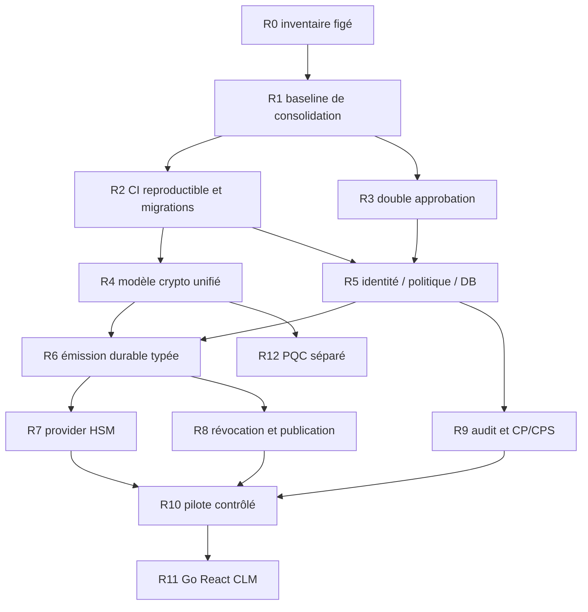

> Recovery execution update: see [EXECUTION_STATUS.md](EXECUTION_STATUS.md). The original PR #42 snapshot below is preserved as historical evidence; it is not the current delivery status.

# Plan de consolidation sans perte de fonctionnalités

> Proposition, non exécutée. Snapshot du 17 octobre 2026 : main `20e977a695481c54c1775a97ae0f1fc427159e43`, #41 `6634b0f20869a4ffc4ce38dba6ea48bbfe2baabd`. Aucune fusion ni modification applicative autorisée par cette PR de rapport.

## Principes

1. Préserver les 41 heads, fonctions publiques, erreurs, migrations, exemples, fixtures et tests. Un module prototype reste conservé, avec statut explicite.
2. Ne pas bulk-merge, réécrire les branches existantes ou prendre #41 comme union parfaite. La [carte](PR_DEPENDENCY_MAP.md) distingue dépendance déclarée et ascendance réelle.
3. Ne promouvoir une ligne de [matrice](FEATURE_MATRIX.md) qu’avec commande, environnement, commit/tree, sortie et critère démontré. Un test présent ou retournant avant connexion DB n’est pas une preuve d’intégration.
4. Une PR de correction doit isoler son comportement; une PR d’intégration doit justifier chaque différence avec tous les heads pertinents. Les approbations G0 et de sécurité existantes restent des gates, pas des booléens auto-attestés.

## Ordre recommandé

Les dépendances indiquent les preuves nécessaires à l’acceptation, pas une interdiction de travailler en parallèle. Aucun calendrier ferme n’est proposé sans capacité d’équipe ni contraintes matérielles connues.

## Lots, risques et critères mesurables

| Lot / priorité | Travail concret | Dépendances | Risque / mesure de maîtrise | Critères d’acceptation |
|---|---|---|---|---|
| **R0 P0** — état de référence | Archiver inventaire SHA/base/CI, récupérer le PRD v0.1, associer les exigences aux preuves | Rapport présent | Branches changeantes, critères perdus | 41 heads et main reproductibles; texte FR-001…012/NFR-01…06 obtenu ou explicitement manquant; aucun « Done » sans preuve |
| **R1 P0** — consolidation source | Nouvelle branche dédiée; préserver roadmap main, assembler les incréments en tenant compte des patches équivalents; conserver les APIs legacy | R0 | Double application de patches, suppression de tests, conflits de module | Diff fonctionnel expliqué face à chaque head; assertions queue vide #23 et déterminisme #24 préservées; correction recovery_budget #41 conservée; aucun fichier/fonction retiré sans équivalent et preuve |
| **R2 P0** — CI et DB fiables | Toolchain unique, locked dependencies, tests features/defaults, DB obligatoire dans job intégration, runner migrations | R1 | Vert trompeur, évolution des outils, migrations destructrices | Build/fmt/clippy/unit/interop sur commit exact; test sans URL DB échoue explicitement dans job intégration; 0001→0010 sur DB neuve et base peuplée; répétition/reprise documentée; grants négatifs sous rôle applicatif; logs archivés |
| **R3 P1** — identité des clés | Corriger S-01 par égalité des points canoniques; vérifier provisioning et consommateurs reviewer | R1 | Rupture des pins existants ou double contrôle fictif | Même clé compressée/non compressée avec IDs distincts rejetée; deux clés réelles acceptées; invalides/replay/nonce/scope rejetés; test Rust exécuté; aucune signature de prod utilisée |
| **R4 P1** — cohérence crypto | Source unique suite/clé/digest/operation/provider/profil/maturité; bridge legacy explicite | R2 | Downgrade implicite ou régression RSA/P256 | Tous chemins existants conservés; catalogue annonce exactement capacités lab; aucun Planned ne vaut qualification; tests matrice policy→dispatch→DER→verification; RSA8192 reste Non vérifié tant que test positif absent |
| **R5 P1** — frontière identité/policy/DB | Adapter identité vérifié, RBAC issuer/scope; TLS et rôles; transaction receipts/challenge; sérialiser activation gates/intents | R2,R3 | Emission non autorisée, TOCTOU, lock/deadlock | Usurpation/expiration/role/tenant/issuer refusés avant signer; SQL direct non autorisé refusé; test C-01 à deux sessions; aucune création d’intent échappant au gate actif; challenge/receipt atomiques |
| **R6 P1** — émission durable typée | Service applicatif étroit reliant CSR exact, autorisation, serial, TBS, suite, key ref, intent, signer, vérification et stockage | R4,R5 | Re-sign après timeout, substitution clé/CSR/profil, divergence journaux | P256 et RSA-PSS SHA256 historiques passent; suites supplémentaires explicitement qualifiées; aucune signature si erreur pré-intent; panne à chaque frontière; une opération unique; replay idempotent; ambiguïté en quarantaine; vérification indépendante avant stockage |
| **R7 P1** — custody/provider réel | Adapter PKCS#11 choisi, provider capability probing, clés non exportables, audit/reconciliation réels | R6, HSM disponible | Matériel indisponible, timeout, sémantique vendor différente | Sign/verify par suite/profil sur vrai matériel; pas clé privée dans DB/logs/disque app; timeout et reprise ambigus sans re-sign; cérémonie, rotation et backup testés; contrats lab conservés |
| **R8 P1** — révocation/publication | État de révocation durable, CRL signée, distribution et validation; OCSP selon périmètre validé | R6 | Certificats révoqués encore acceptés, CRL stale | Révocation autorisée/idempotente, audit corrélé; CRL vérifiée indépendamment, numéros et fraîcheur testés; panne publication ne marque pas Published; monitoring et reprise |
| **R9 P1** — preuve et CP/CPS | Relier audit DB à chaîne/manifest durable, signatures/ancrage/horloge; workflow CP/CPS et export auditeur | R5,R6 pour émission | Fausse immutabilité, fuite données, document auto-approuvé | Tamper/replay/troncature détectés hors DB; bundle offline reproductible avec gaps; deux rôles vérifiés; version/OID/période liée à chaque cert; publication après approbation, redaction et archives; draft reste draft |
| **R10 P1** — pilote | Runbooks, restauration CA/DB/HSM, migrations et retour arrière, SLO, revue sécurité indépendante | R7,R8,R9 et gates G0–G4 | Perte de clés, outage, déclaration prématurée | RTO/RPO et SLO définis puis mesurés; restauration réellement exécutée; pentest/revue crypto; vulnérabilités bloquantes closes; décision humaine de pilote non critique |
| **R11 P2** — Go/React/CLM | Control plane Go, console React, clients, inventaire, renouvellement et ACME puis protocoles retenus | R5,R6; sortie produit après R10 | UI donnant accès à une voie lab, duplication policy | API contract tests, authz serveur, parcours négatifs, audit et isolation; Go/React builds réels; tests E2E renouvellement/révocation; aucune politique contournable côté UI |
| **R12 P2** — PQC | ML-DSA et éventuel KEM dans un périmètre séparé, provider/profile/interop et migration | R4 et exigences explicites | Confusion KEM/signature, compatibilité clients | Vecteurs/conformance/interop réels, taille/latence mesurées, refus fail-closed non supporté, stratégie migration; aucune promotion sur simple enum/gate |

## Stratégie de PR ultérieure

- **PR A — baseline uniquement** : intégration mécanique documentée avec conservation des tests; ne pas mélanger nouveaux services et récupération de contenu. Revue possible par sous-ensembles #1–#8, #9–#16, #17–#19, #20–#40, #41.
- **PR B — harness de preuves** : matrice CI, migration runner, comportement explicite des prérequis; aucun statut vert sans exécution.
- **PR C — correction S-01** : patch ciblé et régression, sans refonte crypto simultanée.
- **PR D — catalogue et interfaces** : préserver compatibilité legacy, qualifiers de maturité et sources de vérité.
- **PR E et suivantes — tranches opérationnelles** : identité/policy/DB, puis émission, custody, révocation/publication, audit/governance.

L’ordre d’acceptation des PR doit suivre le DAG des lots. La séquence « #1 puis #2 … » reste utile pour comprendre l’historique, mais ne suffit pas à intégrer les heads actuels. Toute fusion future nécessite une autorisation distincte; cette mission n’en réalise aucune.

## Contrat de non-régression

Avant la première intégration, produire un inventaire machine des modules publics, signatures, erreurs, SQL tables/fonctions/triggers, fixtures et noms de tests sur tous les SHA. Comparer l’union à la branche proposée; chaque écart doit être classé ajout, équivalence de format, supersession justifiée ou omission bloquante. Les exemples restent exécutables sous les mêmes feature flags.

Tests de conservation minimum :

1. DNS zone boundary, acteurs non autorisés, SAN/CN, doublons SAN, validité et algorithme refusés.
2. CSR canonique/PoP, taille/encodage/sujet/clé falsifiés; substitution de CSR valide même CN rejetée après binding.
3. X.509 P256, RSA-PSS et autres chemins lab existants vérifiés indépendamment; aucune substitution de digest/clé/suite.
4. Serial par issuer, collisions et idempotence; concurrence 12 clients; intent durable avant signer; erreur de vérification sans stockage.
5. Timeout/crash/échec DB à chaque frontière; aucune re-sign automatique; réconciliation et conservation des traces.
6. Receipt collector, double approbation, nonces et replay; identité canonicalisée des clés; gate activation concurrente.
7. CP/CPS déterminisme et draft-only; refus overwrite; OID et période liés aux documents.
8. Contrats audit/capacité/recovery hérités, notamment les assertions latérales non présentes dans #41.

Chaque résultat doit identifier commit testé **et arbre**, environnement, version Rust/PostgreSQL/OpenSSL, features, variables requises sans secrets, commande, exit code et artefact de sortie. Ne pas additionner les suites répétées ou les retours anticipés pour gonfler la couverture.

## Conditions de sortie de la récupération

- Quatre rapports relus, FR manquants explicitement suivis, inventaire sans perte approuvé.
- Branche consolidée reproductible; aucune modification involontaire de main ou PR historique.
- CI finale stricte, tests DB réellement exécutés, migrations et rôles vérifiés.
- S-01 corrigé et testé; C-01 résolu par preuve; dette restante priorisée avec propriétaire.
- Docs, catalogue et matrice cohérents avec les opérations exécutées; aucun prototype qualifié de service.
- La fin de la récupération ne vaut pas autorisation production : cette décision appartient au lot R10 et à ses preuves.
