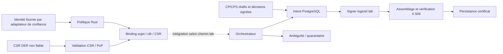

# Audit technique de Trust Platform

> Date : 17 octobre 2026. Périmètre : `knehari/trust-platform`, `main` et les 41 PR Draft ouvertes #1–#41. Rapport documentaire uniquement.

## Conclusion

Le dépôt contient un **socle Rust PKI de laboratoire substantiel**, avec cryptographie réelle, validation CSR, émission X.509, transactions PostgreSQL, vérification avant persistance, protection contre le re-sign après ambiguïté et gouvernance CP/CPS partielle. Ce n’est pas encore une plateforme PKI exploitable : aucun control plane Go, console React, provider HSM réel, service d’authentification, révocation/CRL/OCSP opérationnels ou CLM n’a été trouvé.

Les incréments #20–#40 ajoutent surtout des contrats et prédicats testés. Les numéros « v3/v4 » ne prouvent aucune release. #41 ajoute réellement plusieurs signers classiques et chemins X.509 de laboratoire, au-delà de ce que ses documents décrivent encore.

La consolidation doit préserver les fonctionnalités **et les tests latéraux**. La pile des branches a divergé : #41 ne contient pas deux assertions ajoutées dans #23/#24, ni la roadmap propre à `main`. Les PR #37/#38 ont une CI Rust rouge; cinq PR n’ont aucun check remonté. Un résultat vert de #41 ne transforme pas rétroactivement ces heads en commits validés.

Une faiblesse conditionnelle a été identifiée dans la détection de clés identiques pour la double approbation. Plusieurs risques d’intégration demeurent : activation concurrente des gates SQL à vérifier, entrées de confiance non authentifiées, absence de rôles runtime/TLS, catalogues cryptographiques divergents et chaîne d’audit non ancrée. Aucun défaut n’a été corrigé dans cette PR.

## Références et méthode

| Référence | Identité figée |
|---|---|
| main | `20e977a695481c54c1775a97ae0f1fc427159e43` |
| Head développement #41 | `6634b0f20869a4ffc4ce38dba6ea48bbfe2baabd` |
| Commit réellement checkout par CI #41 | `04056348119b54ade27f4a567395e96baa99ebac` (merge synthétique de #41 dans #40) |
| Arbre du head #41 et de ce merge CI | `202e444b69bacda2817046d0437145f8a9116961` — égalité vérifiée avec Git |
| CI inspectée | [Run 39017432908](https://github.com/knehari/trust-platform/actions/runs/39017432908), `headSha` #41, événement `pull_request`, succès |
| PRD | [v0.2](https://app.notion.com/p/3f6e759bb68e81cc8892f0154b928d6c), lu via connecteur; dernière édition annoncée 12/10/2026 |
| Carte / maturité / plan | [PR_DEPENDENCY_MAP](PR_DEPENDENCY_MAP.md), [FEATURE_MATRIX](FEATURE_MATRIX.md), [RECOVERY_PLAN](RECOVERY_PLAN.md) |

Les métadonnées et SHA des 41 PR, branches de base, ancêtres communs, fichiers modifiés et corrections latérales ont été comparés. Les composants cumulatifs ont été inspectés dans un worktree détaché sur #41; `main` n’a pas été modifié. La branche de rapport part de `origin/main` et ne contient que les quatre fichiers demandés.

La revue statique porte particulièrement sur les trois crates, les dix migrations, le workflow, la cryptographie, la validation des demandes, l’orchestration, les receipts, les frontières identité/autorisation et les contrats récents. Une revue indépendante du cœur persistance/approbation et une cartographie indépendante des frontières ont complété l’examen. La revue cryptographique déléguée n’a pas livré son inventaire final, arrêtée par une limite d’usage; ses observations intermédiaires ne sont pas comptées comme preuve de couverture exhaustive. Le scan de sécurité reste donc **à couverture partielle**, sans prétendre à un audit exhaustif de chaque ligne, de chaque dépendance ou à un pentest.

Le code et les docs sont distingués des assertions des descriptions de PR. Les commentaires/reviews GitHub complets, le code source de toutes les dépendances, les configurations de déploiement externes et l’intégralité du PRD v0.1 n’ont pas été vérifiés. Ces limites font partie des résultats, pas d’une validation implicite.

## Architecture réellement observée

- `trust-pki-policy` autorise les acteurs, noms, profils, validité et suites. `AuthenticatedPrincipal` vient du caller; sa construction n’authentifie personne.
- `trust-pki-core` regroupe CSR, CA lab, X.509, orchestration, journal PostgreSQL, CP/CPS et de nombreux contrats. Cette concentration rend l’intégration et la distinction lab/runtime difficiles.
- `trust-pki-crypto` contient les interfaces legacy, catalogue, suites typées, signers logiciels et wrapper OpenSSL Unix. Les primitives sont réelles; leur qualification et garde des clés ne le sont pas.
- PostgreSQL contient les états, contraintes issuer/request/serial, intents, audit et receipts. Les fonctions vérifient des invariants SQL; elles ne vérifient pas seules signatures X.509, identité humaine ou attestations matérielles.
- Les points d’entrée exécutables sont principalement `examples/` et les tests. Il n’y a pas de service réseau PKI complet, ni projet Go/React.

### Ressources sensibles

| Consommateur | Ressource effective | Contrôle présent | Limite |
|---|---|---|---|
| Signer P256 natif | Clé éphémère en mémoire | Champ privé, référence et algorithme contrôlés | Pas HSM, sauvegarde ou CA durable |
| OpenSSL classique | `<temp_dir>/trust-crypto-<pid>-<counter>/private.pem` | Répertoire 0700, création exclusive 0600, cleanup `Drop` | Clé sur disque; cleanup après crash non garanti, exécutable résolu par PATH |
| `PgIssuanceStore::connect_lab` | Endpoint fourni par connexion; CI `127.0.0.1:5432` | SQL paramétré, DB jetable CI | `NoTls`, pas rôle runtime de production |
| Export CP/CPS | Deux fichiers `.DRAFT.md` sous répertoire choisi | `create_new`, sync, marqueurs draft | Pas publication approuvée |
| Exemple émission | Certificats publics root/leaf sous répertoire CLI | Vérification OpenSSL en CI | Export lab, pas disponibilité de publication |

Sources figées : [provider OpenSSL](https://github.com/knehari/trust-platform/blob/6634b0f20869a4ffc4ce38dba6ea48bbfe2baabd/crates/pki-crypto/src/openssl_classical_lab.rs), [adaptateur PostgreSQL](https://github.com/knehari/trust-platform/blob/6634b0f20869a4ffc4ce38dba6ea48bbfe2baabd/crates/pki-core/src/postgres_store.rs), [orchestrateur](https://github.com/knehari/trust-platform/blob/6634b0f20869a4ffc4ce38dba6ea48bbfe2baabd/crates/pki-core/src/orchestrator.rs).

## Compilation et tests : preuves d’exécution

### Exécuté localement pendant cet audit

| Contrôle | Résultat | Portée |
|---|---|---|
| Clone, refs PR, merge-base, diffs et égalité des arbres | Réussi | Git / cartographie, pas validation applicative |
| Tentative `cargo test --workspace --all-targets --all-features --locked` | Non démarrée : `FileNotFoundError: cargo` | Aucun test Rust local exécuté |
| `psql --version` | Non démarré : `FileNotFoundError: psql` | Aucune migration locale appliquée |
| `docker info` avec timeout 15 s hors sandbox | Timeout | Pas de PostgreSQL local ni conteneur de test lancé |
| Démonstration Python `cryptography` SEC1 | Réussie : 33/65 octets différents, même clé/signature vérifiée | Corrobore le mécanisme S-01; **ne constitue pas l’exécution du vérificateur Rust** |

Aucun changement d’outillage global n’a été imposé. Les vérifications CI historiques ci-dessous sont des exécutions distantes existantes dont les logs ont été lus, pas des relances effectuées par cet audit.

### Exécution distante confirmée pour l’arbre #41

Run [39017432908](https://github.com/knehari/trust-platform/actions/runs/39017432908), terminé le 17 octobre vers 08:32 UTC :

| Étape | Preuve lue | Limite |
|---|---|---|
| `cargo fmt --all -- --check` | Étape réussie | Format uniquement |
| `cargo test --workspace --all-targets --all-features --locked` | 180 résultats `passed`, 0 failed; dont 95 core, 42 crypto, 13 policy et suites d’intégration | Compteur brut inclut des tests DB à retour anticipé; ne signifie pas 180 scénarios complets |
| Clippy mêmes cibles/features, `-D warnings` | Étape réussie | Pas analyse de vulnérabilités ni preuve MSRV |
| CP/CPS CLI | Deux drafts, marqueurs `DO NOT PUBLISH` / `PENDING HUMAN VALIDATION`, absence d’autre fichier | Pas publication |
| RSA-PSS conformance et X.509 | Scripts et roots/leaf natifs exécutés | Paramètres/suites effectivement testés seulement |
| P384/P521/Ed25519/Ed448 | Roots et chaînes TLS OpenSSL validées | Provider OpenSSL, subject P256, pas CSR EdDSA/ECDSA correspondante |
| RSA PKCS1 roots | SHA256/2048, SHA384/3072, SHA512/4096 vérifiés | Pas toutes combinaisons ni RSA8192 positif |
| RSA PKCS10 | CSR générées et vérifiées OpenSSL puis Rust; faux 8192/digest non supporté rejetés | Ne prouve pas support CSR RSA-PSS |
| PostgreSQL 16 migrations 0001→0010 | `ON_ERROR_STOP=1`, job schema réussi | Base neuve, pas upgrade avec données de production |
| Tests Rust du job schema | Groupes de 3 + 6 + 1 + 1 + 5 résultats passés avec `TRUST_CI_DATABASE_URL` | 16 invocations, dont tests purs répétés; ne pas ajouter naïvement aux 180 |
| Concurrence demandes | `PASS: 12 concurrent clients, one request, one serial, four audit events` | Scénario contrôlé |
| Concurrence recovery | `PASS: twelve concurrent recovery workers quarantined exactly one intent` | Pas bascule multi-site |
| Crash réel | `PASS: real X509 signing -> SIGKILL -> separate Rust recovery -> zero re-signs` | Point après signature/vérification, avant stockage |

`postgres_store.rs`, `lab_verified_issuance.rs`, `lab_rsa_pss_postgres.rs`, `lab_policy_gate.rs` et `policy_decisions.rs` comportent des branches `if let Ok(url)` / `let Ok(url) ... else { return; }`. Le job Rust n’injecte pas l’URL DB. Son succès seul ne valide donc pas les branches PostgreSQL. Le job schema l’injecte explicitement et fournit la preuve pertinente.

Le workflow utilise `dtolnay/rust-toolchain@stable` alors que `rust-toolchain.toml` indique 1.99.0 et le workspace annonce MSRV 1.82. Le log installe stable 1.99.1 et fixe l’override de l’action. La compatibilité MSRV 1.82 et une chaîne reproductible unique restent non vérifiées. Les tags Actions et `postgres:16` ne sont pas épinglés par digest dans le YAML.

### Heads antérieurs

34 PR remontent `rust: SUCCESS, schema: SUCCESS`; #37/#38 remontent Rust FAILURE/schema SUCCESS; #23/#24/#25/#39/#40 ne remontent aucun check. Ces statuts ne remplacent pas une lecture des logs de chacune.

Les logs [#37](https://github.com/knehari/trust-platform/actions/runs/38612889008) et [#38](https://github.com/knehari/trust-platform/actions/runs/38613144360) montrent `recovery_budget::tests::rejects_first_missing_requirement` en échec : `left Err(Exhausted)`, `right Err(UnknownOperation)`. #41 attend correctement `Exhausted` et teste séparément le cas opération inconnue. Les descriptions de PR ne doivent pas annoncer une CI finale verte pour les heads sans preuve.

## PostgreSQL : revue des migrations

| Migration | Fonction | Preuve / risque restant |
|---|---|---|
| 0001 | CA, requests, serials, certificats, audit | Contraintes et trigger append-only; pas WORM contre administrateur |
| 0002 | Création idempotente, serial aléatoire positif, transitions | Locks et contraintes testés; conserver clé composite issuer/request |
| 0003 | Intent, TBS hash, résultat et ambiguïté | Pas de vérification cryptographique SQL; trust boundary applicative indispensable |
| 0004 | Recovery des intents non confirmés | Quarantaine, pas re-sign; course recovery couverte CI |
| 0005 | Réconciliation et revue | Acteurs fournis par caller; aucun HSM réel |
| 0006 | Receipt collector / anti-rejeu | Signature vérifiée côté Rust, SQL stocke la preuve |
| 0007 | Observation CA / snapshot CP-CPS / trace | Retrospectif draft, pas autorité de politique |
| 0008 | Approbation et gate pré-sign opt-in | Activation concurrente à vérifier; C-01 |
| 0009 | Receipts double signature et gate | Distinction de clés S-01, provisioning et activation à durcir |
| 0010 | Challenge lab à consommation unique | Atomicité SQL, mais orchestration applicative globale absente |

Toutes commencent par une transaction et sont appliquées dans l’ordre en CI. La validation observée porte sur une base jetable créée par le compte PostgreSQL du service CI, pas sur un rôle d’application à privilèges minimaux. Pas de preuve de migration d’une base remplie, reprise d’échec partiel, checksum/ledger de migration, rollback opérationnel, restauration CA ou test de grants. Les `REVOKE ... FROM PUBLIC` des routines sont utiles mais ne constituent pas un modèle de rôles production.

## Cryptographie et cohérence des contrats

1. **Catalogue legacy périmé.** `algorithm_catalog.rs` classe `RsaPssSha256` `NotImplemented` alors que `rsa_pss_lab.rs` et `rsa_pss_orchestrator_lab.rs` exécutent signature et émission. `select_lab_algorithm` refuse donc un algorithme disponible par d’autres chemins lab. C’est une incohérence de découverte/sélection, pas une preuve de downgrade exploitable.
2. **Catalogue typé conservateur mais non relié à l’exécution.** `planned_classical_suites()` produit des `Planned`, y compris pour des suites exécutables dans `LaboratorySigner`. Séparer candidat, implementation disponible, profil X.509 vérifié, custody et qualification. Ne pas simplement passer tout le catalogue à « production ».
3. **Plusieurs vocabulaires.** `SignatureAlgorithm`, `AlgorithmSuite` et `signer_capabilities::Algorithm` coexistent. Le bridge legacy refuse à raison de deviner une taille RSA. Une migration de types doit préserver toutes les autorisations et erreurs publiques, pas supprimer le legacy avant migration des callers.
4. **Couverture inégale.** P256 et RSA PKCS1 ont un vérificateur CSR réel. P384/P521/Ed25519/Ed448 ont signers et X.509 OpenSSL, mais pas CSR PoP correspondant. RSA-PSS SHA384/512 lab ne prouve pas une émission durable avec toutes suites. RSA8192 est accepté par des branches génériques mais non validé positivement dans la CI inspectée.
5. **PQC déclaratif.** ML-DSA et rollout existent comme types/contrats, pas comme primitive/provider opérationnel. Aucun KEM ne doit être transformé en signature par un mapping d’enum.
6. **Pas de qualification provider.** HSM/KMS sont refusés par `select_lab_provider`; la matrice evidence est une abstraction. Les clés OpenSSL sont temporaires sur disque, les clés natives en mémoire. Aucun cycle durable génération/import/rotation/backup/destruction n’est validé.

## Sécurité : constat, dette et hypothèses séparés

### S-01 — identité des clés de double approbation comparée par encodage

**Faible sévérité dans le périmètre actuel; confiance statique élevée. Priorité de correction P1 avant promotion de la gouvernance.** CWE-187. Aucun exploit réseau ou incident de production établi.

`verify_dual_approval` rejette l’égalité des IDs ou des octets SEC1 (`policy_decisions.rs:130–134`), puis vérifie les deux signatures via `VerifyingKey::from_sec1_bytes` (`pki-crypto/src/lib.rs:94`). Une même clé P256 a des encodages compressé et non compressé différents. Si la configuration de confiance épingle cette même clé sous deux IDs/encodages, le détenteur d’une seule clé peut fournir deux fois la même signature sur le claim canonique et satisfaire ce contrôle de distinction.

Contre-preuve importante : le contrat demande explicitement un provisioning indépendant à deux détenteurs. Deux clés correctement provisionnées ne sont pas affectées. Le risque nécessite une erreur de provisioning; il ne permet pas à un CSR non fiable de remplacer les pins. La démonstration locale a vérifié le mécanisme SEC1 avec Python, **pas exécuté le code Rust**. Le test de régression Rust reste à ajouter/exécuter dans une PR de correction distincte.

Correction proposée : parser les deux clés, comparer leurs points canoniques ou leur identité cryptographique, rejeter l’équivalence et imposer ce contrôle dès l’enregistrement des pins. Tests : même clé sous 33/65 octets et IDs différents rejetée; deux clés distinctes acceptées; mauvais rôle/signature/nonce/replay rejetés.

Sources : [contrôle](https://github.com/knehari/trust-platform/blob/6634b0f20869a4ffc4ce38dba6ea48bbfe2baabd/crates/pki-core/src/policy_decisions.rs#L130), [vérification SEC1](https://github.com/knehari/trust-platform/blob/6634b0f20869a4ffc4ce38dba6ea48bbfe2baabd/crates/pki-crypto/src/lib.rs#L94).

### C-01 — activation des gates pendant une émission : hypothèse de concurrence

L’activation en 0008 verrouille la ligne CA puis cherche les intents existants. La création d’intent en 0003 verrouille la request; le trigger de gate lit l’état d’enforcement sans verrou commun sur l’issuer. Un intent non committé pourrait passer la gate absente pendant qu’une activation ne le voit pas encore. Même question pour le gate dual-signature 0009.

**Non reproduit, non classé comme vulnérabilité confirmée.** Les callers sont de confiance et aucun service exposé n’est établi. Ajouter un test à deux transactions avec barrières, activation vs intent, puis sérialiser sur un verrou commun si le scénario est confirmé. Sources : `0008:137–145,173–184`, `0003:48–50`, `0009:98–114`.

### D-01 à D-07 — dette avant exploitation

| ID | Dette | Impact si intégré sans contrôle | Acceptation |
|---|---|---|---|
| D-01 | Identités/roles/booléens fournis par caller | Faux sentiment d’authentification et de séparation des tâches | Adaptateur protocolaire vérifié, types non forgeables, tests de substitution/expiry/scope |
| D-02 | Gate CP/CPS opt-in, voies lab directes | Émission sans gouvernance dans une intégration qui suppose la gate universelle | API opérationnelle unique, policy binding obligatoire, lab isolé |
| D-03 | DB NoTls / absence de rôles runtime | Confidentialité/autorisation dépendantes de l’hôte | TLS, rôles migrator/service/auditeur, tests grants négatifs |
| D-04 | Audit DB + hashes non ancrés | Administrateur DB capable d’altérer ou reconstruire preuve | Ancrage indépendant, signatures/horloge, export/verifier offline |
| D-05 | Custody lab / OpenSSL via processus | Clés temporaires persistantes après crash, environnement non qualifié | Provider HSM séparé; lab explicitement non production; tests crash et nettoyage |
| D-06 | Supply chain et validation incomplète | Vulnérabilités dépendances non détectées, builds variables | SCA/SBOM, actions/digests pin, fuzzing DER, toolchain cohérente |
| D-07 | Contrats quotas/rétention/PQC/readiness non intégrés | `true` interprété comme preuve, rate limit sans compteur atomique | Vérificateurs de preuves et services réels avant activation |

Le SQL paramétré, les limites DER, la vérification des signatures, le binding TBS, les contraintes issuer/serial et le refus de re-sign constituent des contrôles réels. La recherche textuelle de secrets n’a identifié que des valeurs de test explicites; aucune absence universelle de secrets n’est revendiquée. Une hypothèse de bypass SQL par NULL a été rejetée : le champ audit `decision NOT NULL` force le rollback, et l’adaptateur Rust fournit un `&str` non nullable.

## Écart PRD, roadmap et architecture

- `main` documente correctement une baseline, mais la roadmap s’arrête à #24 pour les incréments existants. Ses versions futures v2.5–v4.0 ne correspondent pas aux petites PR portant les mêmes numéros : v2.6 de roadmap = frontière de service, PR #26 = quorum de témoins; v3.1 de roadmap = Go/IAM, PR #31 = prédicat d’identité. Refaire la correspondance par capacités et critères, pas par version.
- Le README de #41 affirme encore que CSR/X.509/persistance ne sont pas implémentés. Cette phrase est fausse pour le laboratoire. `crypto-agility-by-design.md` annonce seulement un module de politique, alors que des signers réels ont été ajoutés. Les en-têtes de `csr.rs` et `native_typed_csr_binding.rs` disent encore P256 uniquement malgré les chemins RSA.
- La machine d’états proposée contient `PUBLISHED`; la persistance d’un certificat signé ne prouve ni publication ni disponibilité. Le parcours de publication reste absent.
- FR-013…017 sont partiels; FR-018/019 et les workflows conformité/auditeur restent principalement absents. La matrice précise FR-020…026 et NFR-07…11 sans inférer conformité réglementaire.
- Le PRD v0.1 complet reste une source manquante. Les fonctions principales ont été inventoriées indépendamment, mais le mapping exact FR-001…012/NFR-01…06 est **Non vérifié**.

## Décision de consolidation

Préserver la baseline `main` et les 41 SHA; construire ultérieurement une branche d’intégration contrôlée à partir de l’inventaire, sans considérer #41 comme une union parfaite. Restaurer les deux intentions de tests latéraux, corriger S-01 séparément, rendre la CI exacte/reproductible, puis intégrer une tranche émission authentifiée durable. Les modules prototypes restent conservés et étiquetés; leur promotion dépend de preuves exécutables. Voir le plan avec dépendances et critères d’acceptation.

## Empreintes des preuves collectées

Les commandes de collecte sont reproductibles via `gh pr list`, `gh run view --json` et `gh run view --log`. Les logs bruts restent des artefacts locaux de travail; cette PR publie seulement les quatre rapports.

| Artefact collecté | SHA-256 |
|---|---|
| Métadonnées 41 PR, JSON | `110aa6590089bbcaa210bdc9b50c59f6ee77246a07c9f35ce1e37dc165a32cd7` |
| Log complet CI 39017432908 | `0ec856d9d10ca6f8642eb5eb878e524110acccaa6559fcdd2fe3107d5c910d82` |

Ces empreintes identifient les captures consultées; elles ne remplacent pas les liens GitHub et n’attestent pas une relance locale.
